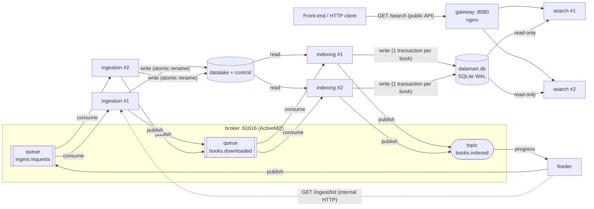

# Architecture — Stage 2

Status: **binding contract** for issues #2–#9. Change it only through a pull request that every
affected owner approves. Companion contracts: [DATAMART.md](DATAMART.md) (storage shared by
Indexing and Search) and [EVENTS.md](EVENTS.md) (broker messages).

## 1. Goal in one paragraph

The Stage 1 pipeline (download → split → index → query) becomes independent Java processes that
run on **one machine**. They cooperate by **choreography**: each service reacts to messages on an
ActiveMQ broker and publishes a message when its own work is complete. No central controller
decides the order; the order is enforced by the messages themselves (a book can only be indexed
after a `books.downloaded` message exists for it, and that message is only sent after the files
are complete). The front-end talks only to the Search API, through a gateway.

## 2. Components

| Process | Responsibility | Port | Replicas | Writes | Reads |
|---|---|---|---|---|---|
| `broker` | Embedded ActiveMQ broker, persistent messages | 61616 | 1 | broker store | – |
| `feeder` | Chooses which books to ingest, reports progress | 7004 | 1 | broker | Ingestion API |
| `ingestion-service` | Downloads and splits books into the datalake | 7001 | 1..N | datalake, `control/` | Gutenberg / mirror |
| `indexing-service` | Builds metadata + inverted index | 7002 | 1..N | datamart | datalake |
| `search-service` | Front-end search API | 7003, 7013, 7023… | 1..N | – | datamart (read-only) |
| gateway (nginx) | Single front-end entry point, round-robin over Search replicas | 8080 | 1 | – | – |

Every Java process is one executable jar (`<module>/target/<module>.jar`) configured as described
in the README (defaults < `CONFIG_FILE` < environment variables < `-D`).

## 3. Diagram



Legend: solid arrows into the gateway are the **public** API; everything else is internal.
Each box marked `#1`, `#2` is a **replica** (separate process). Threads live inside a box and are
described in §6.

## 4. Life of a book

| Step | Who | Effect | Made durable in |
|---|---|---|---|
| 1. requested | feeder (or `POST /ingest/{id}`) | message on `ingest.requests` | broker store |
| 2. downloaded | an ingestion replica | header + body + receipt written | datalake, `control/ingestion/` |
| 3. announced | same replica | message on `books.downloaded` | broker store |
| 4. indexed | an indexing replica | metadata + postings committed | `datamart.db` (one transaction) |
| 5. searchable | – | visible to every new Search read transaction | same commit as step 4 |
| 6. reported | same indexing replica | message on `books.indexed` | – (informational) |

Rules that make this correct:

- **Ingestion before indexing**: step 3 is sent only after step 2 is fully on disk (atomic writes,
  then receipt). Indexing never scans the datalake on its own; it only reacts to step 3.
- **Consistent search**: steps 4 and 5 are the same SQLite commit. A Search request runs in one
  read transaction, so it sees either all of a book or none of it.
- **No duplicates**: every consumer is idempotent (re-ingesting rewrites identical files;
  re-indexing replaces the book's rows). Duplicated messages therefore waste work but never corrupt
  data. Details in EVENTS.md §4.
- **Crashes**: a message is acknowledged only after the work and the next message are committed,
  so a process that dies mid-way leaves its message in the broker for another replica. Details in
  EVENTS.md §5.

## 5. Storage on disk

Everything lives under the workspace root `data.dir` (default `./data`), shared by all processes
on the host:

```
data/
├── datalake/<id6[0:2]>/<id6[2:4]>/<id>.header.txt   # Stage 1 "hash" layout (SPEC §4)
├── datalake/<id6[0:2]>/<id6[2:4]>/<id>.body.txt
├── control/
│   ├── ingestion/hash/<id>.json        # receipt = "book is complete" marker (SPEC §1.2)
│   ├── claims/<id>.lock                # per-book lock held while a replica downloads it
│   └── failed_books.txt                # <id>\t<REASON>\t<ISO8601>, permanent failures
├── datamarts/datamart.db               # metadata + inverted index (DATAMART.md)
└── broker/                             # ActiveMQ KahaDB store
```

The `hash` layout is the Stage 1 winner for lookup by id, which is the only datalake access
Stage 2 needs (Indexing reads one book at a time, by id).

## 6. Processes, replicas and threads

| Service | Replicas | Threads inside one replica | Shared state and its protection |
|---|---|---|---|
| ingestion | 1..N, competing consumers on `ingest.requests` | `consumer.threads` consumer sessions (default 4) + Jetty request threads | Per-book lock: OS file lock `control/claims/<id>.lock` between replicas + in-process lock between threads; atomic rename for every file |
| indexing | 1..N, competing consumers on `books.downloaded` | `consumer.threads` consumer sessions (default 2) + Jetty threads | SQLite: one writer at a time (`BEGIN IMMEDIATE` + `busy_timeout`) |
| search | 1..N behind the gateway | Jetty request threads `server.threads.min/max` (default 8/250) | None written; read-only connections, one read transaction per request |
| feeder | 1 | 1 publisher + Jetty threads | – |
| broker | 1 | ActiveMQ internal | KahaDB |

- **Replicas** add processes; the broker distributes messages among them (prefetch 1, so a busy
  replica does not hoard messages). The gateway distributes HTTP requests among Search replicas.
- **Threads** add concurrency inside one process. An in-process lock protects threads of one
  process only, so every rule that must hold *between replicas* uses an OS-level mechanism
  (file lock, atomic rename, SQLite locking, broker delivery).
- Expected contention, to be measured in #8: SQLite allows **one writer at a time**, so adding
  Indexing replicas helps only while parsing and tokenizing dominate over the write; adding
  Ingestion replicas helps until the network or the disk saturates; adding Search replicas helps
  until the CPU saturates (all replicas share the same cores).

## 7. Public, internal and operational interfaces

| Kind | Consumer | Provider | Defined in |
|---|---|---|---|
| Public (front-end) | browser / HTTP client via gateway | search-service | issue #5, `api/openapi.yaml` |
| Internal HTTP | feeder | ingestion-service (`GET /ingest/list`) | `api/openapi.yaml` |
| Internal messages | services | broker | [EVENTS.md](EVENTS.md) |
| Shared storage | indexing (write), search (read) | `datamart.db` | [DATAMART.md](DATAMART.md) |
| Operational | operators, scripts, benchmarks | every service: `GET /status`; admin routes such as `POST /index/rebuild` | `api/openapi.yaml` |

The front-end never reads files, the database or the broker directly. CORS is enabled on Search
because a browser front-end may be served from another origin.

## 8. What depends on a single host (input for the Stage 3 report)

| Assumption | Why it works now | What changes on a cluster |
|---|---|---|
| `localhost` addresses | all processes on one machine | real host names, service discovery |
| Shared `data/` directory | one file system | shared/distributed storage or data sent through messages |
| File locks and atomic rename | one kernel | distributed locking or ownership by partition |
| SQLite single file, one writer | one disk | a database server or a partitioned index |
| Embedded single broker | one process | broker cluster / network of brokers |
| nginx on one host | one machine | load balancer in front of nodes |

## 9. Decisions and reasons

| Decision | Reason |
|---|---|
| Choreography with a broker (not a Control Module) | No single point of failure; replicas are just more consumers; acknowledgements and redelivery come from the broker; the same design moves to Stage 3. |
| ActiveMQ Classic, embedded in its own jar | Pure Java, no Docker or separate installation on the Stage 2 machine. |
| SQLite (one file for metadata and index) | Transactions give atomic, consistent publication of each book; WAL lets readers work while one writer writes; the schema is the Stage 1 one, already benchmarked. |
| Stage 1 `hash` datalake layout | Fastest lookup by id in Stage 1 (E2). |
| Java port checked against Stage 1 oracles | `tokens_20.jsonl` and the canonical-export hash prove the Java code behaves exactly like Stage 1. |
