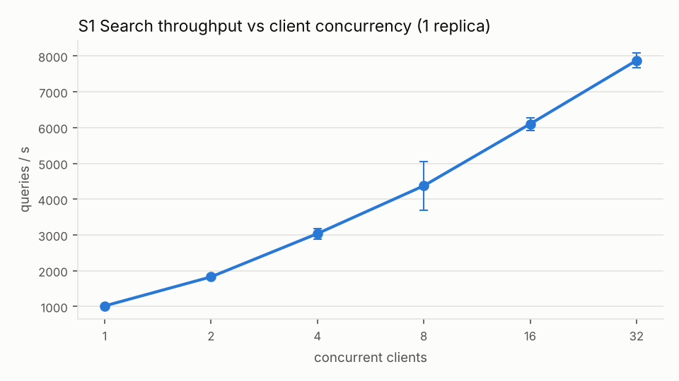
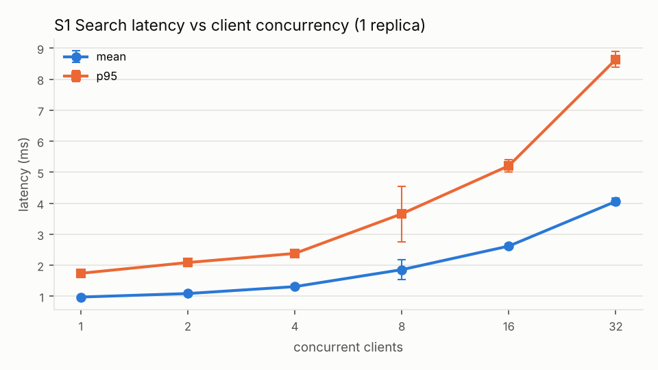
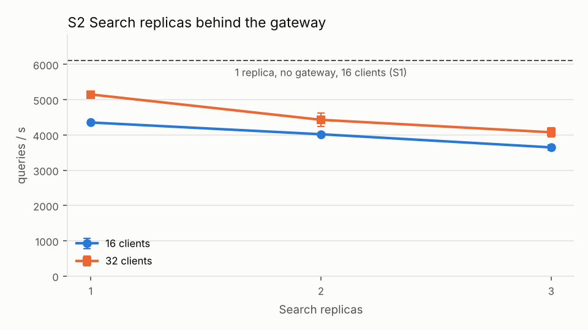
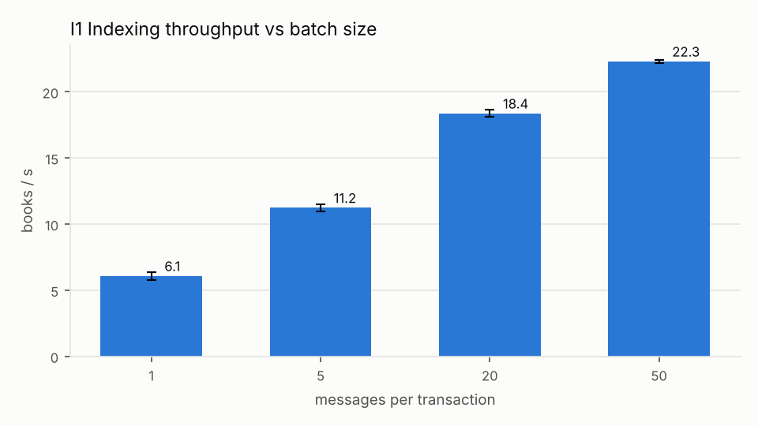
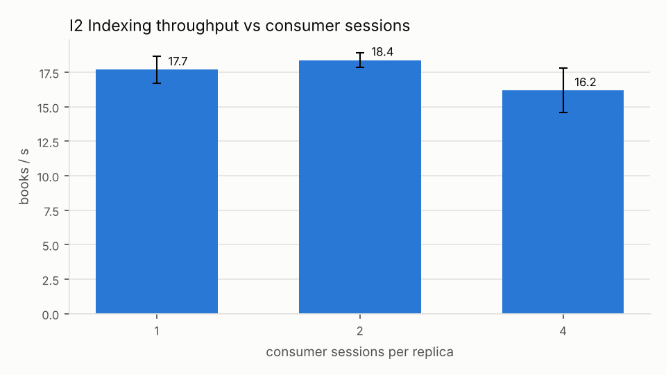
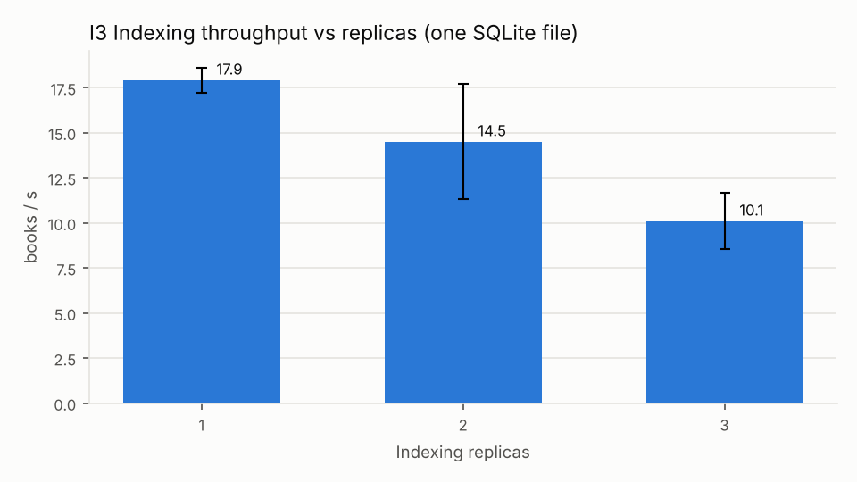
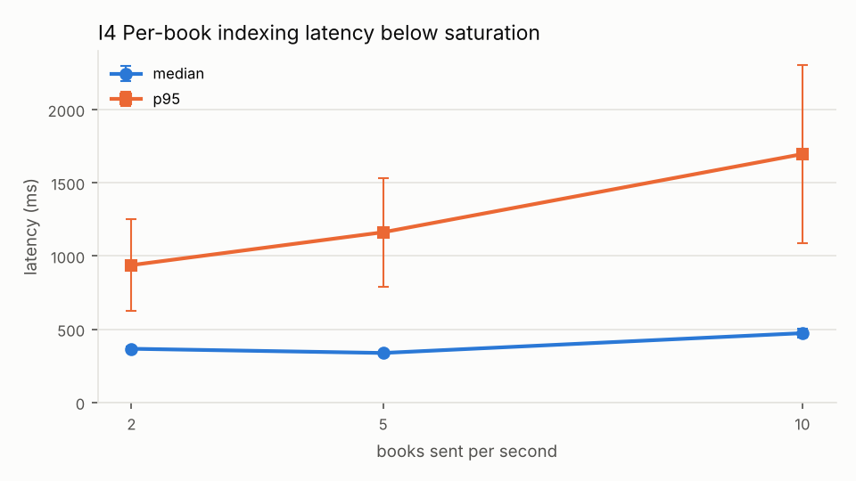
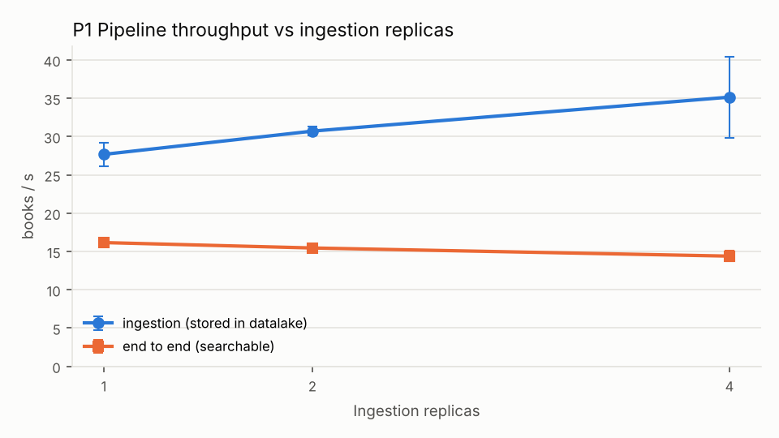
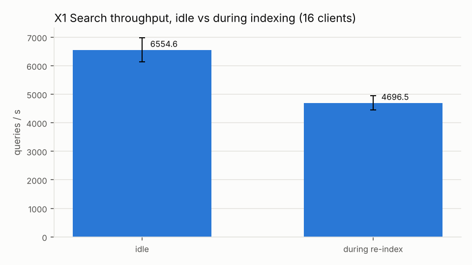
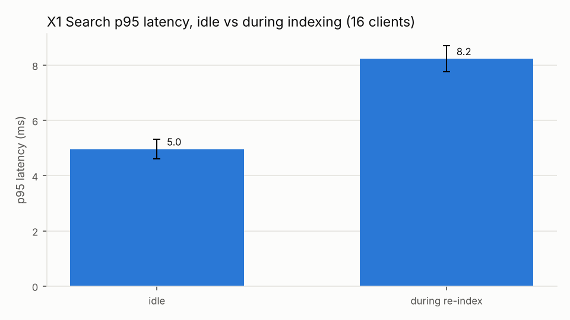

# Integration benchmark results (#8)

Plan and method: `docs/INTEGRATION_BENCHMARK.md`. Raw results:
`results/integration/20261104-1701/` (per run: `summary.json`, CSV of books / per-second search
timeline / broker queues / CPU and memory, `deployment.env`). Figures: `docs/img/integration/`,
regenerated with `python3 scripts/plot-integration.py <aggregate.csv> docs/img/integration`.

**Every value is the mean ± standard deviation of 3 runs** of the same configuration, unless
stated otherwise. All runs passed the checks (no lost book, no error, nothing in the DLQ).

## 1. Setup

| Item | Value |
|---|---|
| Host | laptop, Intel Core i7-1255U (hybrid: 2 performance + 8 efficiency cores, 12 logical CPUs as seen by WSL), Windows + WSL 2 Ubuntu, 10 GiB RAM for WSL |
| Runtime | OpenJDK 21.0.12 (code compiled for Java 17), nginx 1.28.3, heap 64 MiB–512 MiB per JVM |
| Code | commit `19e2b1b` (2026-11-04), `scripts/bench-integration.sh` with the #7 deployment scripts |
| Data | tier 1000: 1000 books already in the datalake (`~/bench/s2-tier1000`); datamart of 1000 books, 366,187 terms |
| Search workload | 300 queries (`bench/queries-tier1000.txt`): terms from 3 equal document-frequency groups; 70 % one term, 30 % two terms; **22.7 % of the answers have 0 results** (two-term queries with no common book) |
| Baseline | 1 replica per service; indexing 2 consumer sessions, batch 20, batch wait 200 ms; HTTP threads 8–64; 1 nginx worker |
| Search runs | closed loop (each client sends the next query as soon as it gets the answer), 10 s warm-up not measured, 60 s measured (X1: 5 s + 30 s) |
| Indexing runs | I1–I3: the 1000 `BookDownloaded` messages sent at once (saturation); I4: sent at a fixed rate |

Limits of the setup: client, broker and services share the same machine, so the load generator
takes CPU from the system it measures and its time is inside the measured latency. The laptop CPU
changes frequency with temperature and power (turbo), which explains part of the run-to-run spread.
CPU and memory figures describe Linux/WSL, not the whole Windows host.

## 2. Search

### S1 — client concurrency (1 replica, direct port, no gateway)

| Clients | Queries/s | Mean ms | p95 ms | p99 ms |
|---|---|---|---|---|
| 1 | 1017 ± 4 | 0.98 ± 0.01 | 1.74 ± 0.04 | 2.37 ± 0.07 |
| 2 | 1829 ± 55 | 1.09 ± 0.04 | 2.09 ± 0.05 | 2.61 ± 0.14 |
| 4 | 3037 ± 149 | 1.31 ± 0.07 | 2.38 ± 0.09 | 3.09 ± 0.15 |
| 8 | 4373 ± 674 | 1.86 ± 0.31 | 3.66 ± 0.90 | 6.27 ± 3.00 |
| 16 | 6101 ± 177 | 2.62 ± 0.08 | 5.21 ± 0.20 | 7.88 ± 0.66 |
| 32 | 7875 ± 208 | 4.06 ± 0.11 | 8.64 ± 0.26 | 12.69 ± 0.43 |

Throughput grows almost linearly up to 4 clients, then less and less: from 16 to 32 clients +29 %
queries/s for +66 % p95. At 32 clients the Search process uses ~7 logical CPUs (p90 703 %) and the
host is at 78 % on average, 96 % peak, with the client on the same machine: **the limit is the CPU
of the host**, not a lock (Search only reads). The 8-client configuration has a high spread (one
disturbed run); its mean should be read with that in mind.

### S2 — Search replicas behind the nginx gateway

| Replicas | 16 clients q/s | p95 ms | 32 clients q/s | p95 ms |
|---|---|---|---|---|
| 1 | 4353 ± 44 | 6.10 ± 0.10 | 5147 ± 102 | 10.54 ± 0.37 |
| 2 | 4019 ± 38 | 6.74 ± 0.08 | 4428 ± 192 | 12.86 ± 0.99 |
| 3 | 3647 ± 75 | 7.78 ± 0.28 | 4074 ± 125 | 14.46 ± 1.18 |

- **Gateway cost:** with one replica and 16 clients, going through nginx lowers throughput from
  6101 to 4353 q/s (−29 %) and adds ~1 ms to the mean. The single nginx worker uses ~75–80 % of one
  CPU: it is busy but not saturated, so the cost is mostly the extra hop (one more process, one more
  connection per request) competing for the same CPU.
- **More replicas lower throughput** on this machine. Three replicas use more CPU in total than one
  (p90 ~290 % each, ~880 % together, against ~650 % for one) and serve fewer queries: the cores are
  shared, so replication only adds JVMs, context switches and per-process caches. Replication of
  Search cannot help when one replica already uses most of the CPU; it is a **multi-machine** tool
  (Stage 3).

## 3. Indexing

### I1–I3 — throughput at saturation (1000 books sent at once)

| Experiment | Configuration | Books/s | ms/book |
|---|---|---|---|
| I1 batch size | 1 / 5 / 20 / 50 | 6.08 ± 0.28 / 11.23 ± 0.29 / 18.37 ± 0.27 / 22.30 ± 0.11 | 165 / 89 / 55 / 45 |
| I2 consumer sessions | 1 / 2 / 4 | 17.69 ± 1.00 / 18.39 ± 0.53 / 16.19 ± 1.61 | 57 / 54 / 62 |
| I3 replicas | 1 / 2 / 3 | 17.92 ± 0.68 / 14.51 ± 3.19 / 10.10 ± 1.55 | 56 / 72 / 101 |

- **Batching is the factor that matters:** 3.7× from 1 to 50 messages per transaction. Fewer
  transactions mean fewer commits and fewer document-frequency updates per book (same result as the
  JMH microbenchmarks, `results/jmh/20261028-1138`). From 20 to 50 the gain is still +21 %.
- **More sessions do not help:** reading and tokenizing already run in parallel inside a batch
  (the indexing process reaches ~4 CPUs), and the write is serial.
- **More replicas make it worse:** 3 replicas reach only 56 % of one replica's throughput, while
  the host stays at ~26 % CPU on average. The replicas are not short of CPU: they wait for each
  other on the single SQLite file (one writer at a time) and each one's page cache is invalidated
  by the others' commits. This confirms the expected bottleneck of `docs/ARCHITECTURE.md` §6:
  **the single SQLite writer**.

The latency of these runs (mean 19–71 s) is time waiting in the queue behind the other books
(the broker's average time in queue is 77–99 % of it); it describes the backlog, not the cost of a
book. The per-book latency is measured by I4.

### I4 — per-book latency below saturation (200 books, batch 20)

| Sent books/s | Indexed books/s | Median ms | Mean ms | p95 ms | Time in queue ms |
|---|---|---|---|---|---|
| 2 | 2.02 ± 0.01 | 366 ± 15 | 436 ± 44 | 937 ± 312 | 2 ± 1 |
| 5 | 5.02 ± 0.05 | 337 ± 5 | 446 ± 44 | 1162 ± 370 | 4 ± 3 |
| 10 | 10.08 ± 0.07 | 473 ± 32 | 690 ± 166 | 1695 ± 606 | 27 ± 16 |

**Indexing latency: ~0.35 s per book (median) when the system is not saturated.** About 200 ms of it is
the batch wait (`consumer.batch-wait-ms`): with little traffic a batch waits for more messages
before writing. Lowering the wait would reduce latency at low load and reduce throughput at high
load, a trade-off we keep at 200 ms. The p95 (~1 s) and its spread are probably due to the largest
books (indexing cost grows with size: 7.4 ms to insert an 8.7k-token book, 85.6 ms for a 36k-token
one in the JMH microbenchmarks) and to occasional pauses (garbage collection, SQLite checkpoints);
we did not measure which one dominates.

## 4. Full pipeline — P1 ingestion replicas (1000 books from a local mirror)

| Ingestion replicas | Ingestion books/s | End-to-end books/s | Mean latency s | p95 s |
|---|---|---|---|---|
| 1 | 27.67 ± 1.55 | 16.16 ± 0.41 | 12.7 ± 1.2 | 25.3 ± 1.1 |
| 2 | 30.71 ± 0.57 | 15.46 ± 0.09 | 15.8 ± 0.6 | 31.4 ± 0.3 |
| 4 | 35.14 ± 5.29 | 14.39 ± 0.71 | 19.5 ± 0.8 | 39.5 ± 1.1 |

Ingestion alone scales a little with replicas (+27 % with 4), but the books become searchable at
**the speed of indexing** (~16 books/s, close to I1 with batch 20): the extra books wait in the
`books.downloaded` queue (average time in queue 10.1 → 16.6 s) and the extra ingestion processes
take some CPU from indexing. Adding ingestion replicas is useless until indexing is faster.

## 5. Interference — X1 search during a re-index (16 clients, 1 replica each), X0 control

| | Search q/s | Search p95 ms | Search p99 ms | Indexing books/s |
|---|---|---|---|---|
| Idle | 6555 ± 417 | 4.96 ± 0.35 | 7.38 ± 0.65 | – |
| Re-index only (X0, no search load) | – | – | – | 10.01 ± 1.20 |
| During re-index | 4696 ± 247 | 8.23 ± 0.47 | 15.16 ± 1.09 | 9.08 ± 0.17 |

Indexing costs Search −28 % throughput, +66 % p95 and 2× p99. The effect on indexing is small:
the same re-index without search load (X0) runs at 10.0 ± 1.2 books/s, against 9.1 ± 0.2 under
search load (−9 %, within the run-to-run variation of X0). I1 (18.4 books/s) is **not** the right
baseline: it inserts new books into an empty datamart, while a re-index first deletes the existing
rows of every book and is slower. X0 was run on 8 Nov 2026 (`results/integration/20261108-1747`),
same host and same service code as the other runs; only the runner changed. During the run Search uses ~5.5 CPUs and indexing
~3.3 (p90): together they fill the host. SQLite in WAL mode lets readers and the writer work at the
same time, so the main cause is **CPU contention**; WAL growth while readers are active may add to
it (not measured separately).

## 6. Coordination cost

- Below saturation (I4) a message waits **2–27 ms** in the broker, against ~350 ms per book from
  publication to commit (median, including the 200 ms batch wait): the broker adds little. `ingest.requests` waits 1–2 ms in P1.
- At saturation every second of extra latency is queue time in front of indexing: the queue is
  where the backlog becomes visible, not a cost of the broker itself.
- Broker CPU: ~0.4–0.5 CPU (p90) at ~18 messages/s in and out; memory ~160 MiB.

## 7. Resources (run 1 of each configuration, p90 of 1-second samples)

| Configuration | Host CPU mean / p90 | Main processes CPU p90 (100 % = 1 logical CPU) | Max RSS |
|---|---|---|---|
| S1 32 clients | 78 % / 87 % | search 703 % | search 265 MiB |
| S2 1 replica, 32 clients | 72 % / 80 % | search 646 %, nginx worker 79 % | search 258 MiB |
| S2 3 replicas, 32 clients | 79 % / 93 % | search 314 + 291 + 275 %, nginx worker 75 % | 3 × ~240 MiB |
| I1 batch 20 | 24 % / 34 % | indexing 380 %, broker 43 % | indexing 1.0 GiB |
| I3 3 replicas | 26 % / 57 % | indexing 301 + 266 + 291 % | 3 × ~1.0 GiB |
| P1 4 ingestion replicas | 31 % / 50 % | indexing 360 %, ingestion 4 × ~50 % | indexing 1.0 GiB, ingestion 4 × ~320 MiB |
| X1 during re-index | 37 % / 78 % | search 547 %, indexing 326 % | indexing 958 MiB |

The indexing process holds ~1 GiB (heap up to 512 MiB plus the 256 MiB SQLite page cache):
three replicas need ~3 GiB on a 10 GiB WSL machine. The client's own CPU is not in the table but is
inside the host figures.

## 8. Conclusions for the architecture

1. **Indexing is the bottleneck of the pipeline**, and inside indexing the single SQLite writer:
   batching helps (3.7×), threads do not, replicas on the same file hurt (−44 % with 3).
   Ingestion and Search have spare capacity relative to it.
2. **On one machine, replication does not scale** any service measured here: Search is limited by
   the CPU (replicas share it), indexing by the database file. Replicas give fault tolerance (the
   #7 failover test) but not speed on one host.
3. **Search and indexing interfere** through the shared CPU: Search pays most of it (−28 % q/s,
   +66 % p95); indexing slows only ~9 % (X0 control, within the noise).
4. **What Stage 3 must change:** replicas on separate machines (Search scales only with more CPUs);
   an index that accepts parallel writers — partitioned by term or by book, or a database server —
   instead of one SQLite file; datalake and datamart reachable over the network instead of local
   paths; a gateway with more workers or one per node.

Evidence missing or partial: no Windows-level CPU figures; nginx with more workers not tested;
the cause of the I4 p95 tail (large books vs pauses) not separated; one run per configuration for
the CPU table.
